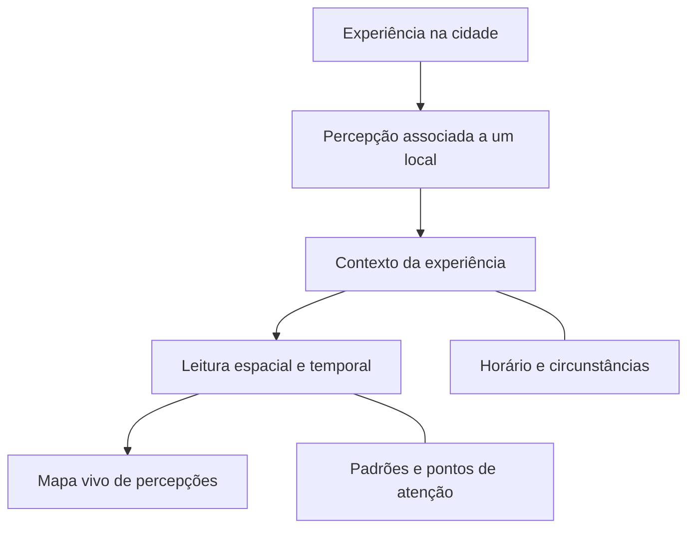

### Percepção de segurança urbana, com contexto.

Transformar experiências cotidianas em uma camada de inteligência territorial para compreender a cidade.

**Campinas · São Paulo · Brasil**

[Conheça a proposta](#a-cidade-além-dos-indicadores) · [Encontre seu público](#para-quem-essa-inteligência-pode-ser-útil) · [Entenda o fluxo](#da-experiência-à-leitura-do-território)

---

## A cidade além dos indicadores

**O mesmo lugar pode ser vivido de formas diferentes.** O horário, a iluminação, a movimentação e a familiaridade com uma região influenciam a percepção de quem passa por ela.

A **Zanza** é uma plataforma de percepção de segurança urbana cuja proposta é organizar essas experiências por lugar e contexto. Ao conectar relatos do cotidiano, busca tornar visíveis padrões que complementem a leitura tradicional dos territórios.

> **A pergunta que nos orienta:** como as pessoas percebem e vivenciam este lugar?

## Para quem essa inteligência pode ser útil?

| Se você atua com… | A pergunta que a Zanza busca ajudar a explorar |
| :--- | :--- |
| **Gestão pública e planejamento urbano** | Onde as percepções das pessoas apontam questões que merecem investigação e escuta? |
| **Pesquisa, escolas e universidades** | Como o contexto e os diferentes momentos do dia influenciam a experiência no território? |
| **Organizações sociais e comunidades** | Quais experiências recorrentes precisam ganhar visibilidade nas discussões sobre a cidade? |
| **Comércio e mercado imobiliário** | Como o entorno é percebido e quais aspectos da experiência urbana merecem atenção? |
| **Pessoas que vivem e circulam pela cidade** | Como outras pessoas vivenciam os espaços que fazem parte do cotidiano? |

**O valor está em compreender experiências com contexto, preservando a complexidade de cada território.**

## Da experiência à leitura do território

A proposta conecta **o que foi percebido**, **onde** e **em quais circunstâncias**. Essa combinação permite explorar como as experiências variam entre lugares e ao longo do tempo.

## Quatro dimensões para olhar a cidade

<table>
<tr>
<td width="50%" valign="top">

### Ambiente
Iluminação, infraestrutura, acessibilidade, limpeza e condições do espaço.

**Pergunta:** como as condições do lugar participam da experiência?

</td>
<td width="50%" valign="top">

### Riscos percebidos
Elementos relatados como fontes de desconforto ou vulnerabilidade.

**Pergunta:** o que desperta atenção na percepção de quem passa?

</td>
</tr>
<tr>
<td width="50%" valign="top">

### Contexto
Horário, familiaridade com o local, companhia e circunstâncias da experiência.

**Pergunta:** em que situação essa percepção aconteceu?

</td>
<td width="50%" valign="top">

### Transporte e mobilidade
Condições e percepções relacionadas aos deslocamentos.

**Pergunta:** como o trajeto e a mobilidade influenciam a vivência?

</td>
</tr>
</table>

## Um exemplo de leitura

> **Cenário ilustrativo — não representa dados coletados pela Zanza.**
>
> Em um mesmo entorno, relatos durante o dia mencionam movimentação e facilidade de acesso. À noite, outras experiências destacam iluminação e espera pelo transporte.
>
> A leitura útil é identificar **o que muda, quando muda e quais questões merecem investigação**.

## Percepção com responsabilidade

Percepções são experiências situadas. Não equivalem, por si só, a ocorrências registradas ou a uma medida objetiva de segurança.

A proposta da Zanza é **complementar a compreensão urbana**. A plataforma não oferece garantia de segurança, orientação de rotas seguras ou atendimento de emergência. A interpretação dos relatos exige atenção ao contexto e à representatividade das contribuições.

> **As pessoas são a fonte da inteligência da Zanza — não o produto.**

**ZANZA**

Uma cidade pode ser medida. Uma cidade também pode ser percebida.

**Inteligência humana para entender a cidade.**

Campinas · Brasil

